# Perturbative Gravity on de Sitter Spacetime

### Metric Fluctuations, Gauge Symmetry, Tensor Dynamics, and Quantum Foundations

A computational research framework that derives, implements, tests, visualizes and cross-checks linearized and second-order gravity on exact de Sitter spacetime. Every analytic statement made in the documentation is backed by either an exact symbolic residual that simplifies to zero or a numerical comparison against a closed-form solution, and most checks are accompanied by a deliberately wrong negative control that must fail.

This project does not solve quantum gravity. Its quantum content is the free, canonically quantized graviton field on a fixed de Sitter background, which is textbook physics; the contribution here is a transparent, reproducible, machine-verified implementation. See [Limitations](#limitations).

---

## Contents

1. [Headline results](#headline-results)
2. [Epistemic status of each result](#epistemic-status-of-each-result)
3. [Physics summary](#physics-summary)
4. [Figure gallery](#figure-gallery)
5. [Repository layout](#repository-layout)
6. [Installation and quick start](#installation-and-quick-start)
7. [Verification framework](#verification-framework)
8. [Reproducing the results](#reproducing-the-results)
9. [Documentation index](#documentation-index)
10. [Limitations](#limitations)
11. [Citation and license](#citation-and-license)

---

## Headline results

| Quantity | Result |
|---|---|
| Verification records | 128 passing of 128, including 9 negative controls |
| de Sitter curvature | $R_{\mu\nu\rho\sigma}=H^2(g_{\mu\rho}g_{\nu\sigma}-g_{\mu\sigma}g_{\nu\rho})$ on all 256 components, in two slicings |
| Linearized Einstein tensor | covariant derivation and brute-force metric expansion agree identically |
| Linearized Bianchi identity | verified; the naive coordinate divergence is nonzero, the covariant one vanishes |
| SVT gauge laws | derived by matching $\mathcal L_\xi\bar g$, not assumed |
| Degrees of freedom | $10-4-4=2$ |
| Quadratic tensor action | two independent routes agree up to a total derivative |
| Canonical variable | $z_T^2=M_{\rm pl}^2a^2/2$ with $e_{ij}e_{ij}=2$, derived by coefficient matching |
| Tensor spectrum | $\Delta_t^2=\dfrac{2H^2}{\pi^2M_{\rm pl}^2}\,(1+x^2)$, $x=k/(aH)$ |
| Solver accuracy vs exact ($\mathrm{rtol}=10^{-10}$) | $5.5\times10^{-10}$ to $7.9\times10^{-10}$ across four formulations |
| RK4 observed convergence order | $4.003$ |
| Spectrum, numeric vs exact | $9.9\times10^{-12}$ |
| Wronskian drift | $6.3\times10^{-11}$ |
| mpmath high-precision cross-check | $2.6\times10^{-13}$ |
| Gauge-invariant change under a gauge shift | $3.6\times10^{-15}$ |

---

## Epistemic status of each result

| Class | Meaning | Items |
|---|---|---|
| Established | Textbook or standard literature results, reproduced here | de Sitter geometry, linearized Einstein equations, Bardeen potentials, SVT decomposition, tensor mode equation, Bunch-Davies state, scale-invariant tensor spectrum |
| Independently verified here | Established results re-derived in code by at least two routes, with negative controls | Quadratic action (direct expansion versus $-\tfrac12\sqrt{-\bar g}\,h^{\mu\nu}\delta E_{\mu\nu}$), linearized Bianchi identities, SVT transformation laws, Wronskian normalization, four-formulation solver agreement |
| Exploratory | Observations of this implementation, correct but modest | Leading-WKB initial data at finite $x_{\rm start}$ equals a Bogoliubov state with $\lvert\beta\rvert=1/(2x_{\rm start}^2)$; small-$k$ noise amplification in the periodic-box SVT inversion |
| New | Genuinely new physics | None claimed |

---

## Physics summary

Conventions are fixed in [docs/conventions.md](docs/conventions.md): signature $(-+++)$, $R^\rho{}_{\sigma\mu\nu}=\partial_\mu\Gamma^\rho_{\nu\sigma}-\dots$, $R_{\sigma\nu}=R^\rho{}_{\sigma\rho\nu}$, so the unit 2-sphere has $R=+2$. The curvature sign is itself tested with a negative control.

**Background.** Flat-slicing de Sitter, $a=-1/(H\eta)$, has $R=12H^2$, $G_{\mu\nu}=-3H^2g_{\mu\nu}$ and $\Lambda=3H^2$. The action is

$$
S=\frac{1}{16\pi G}\int d^4x\,\sqrt{-g}\,(R-2\Lambda).
$$

**Perturbations.** $g=\bar g+\epsilon h$. The inverse metric and $\sqrt{-g}$ are expanded to fourth order (Neumann series and the exact characteristic polynomial), with measured truncation slopes $1,2,3$.

**Gauge symmetry.**

$$
h_{\mu\nu}\to h_{\mu\nu}-\bar\nabla_\mu\xi_\nu-\bar\nabla_\nu\xi_\mu .
$$

For a general SVT metric the transformation laws are obtained by matching $\mathcal L_\xi\bar g$. The gauge invariants are

$$
\Phi_B=A-\sigma'-\mathcal H\sigma,\qquad \Psi_B=\psi+\mathcal H\sigma,\qquad V_i=S_i-F_i',\qquad \sigma=E'-B .
$$

Residual gauge freedom: none in Newtonian gauge, $T=C/a$ in synchronous gauge, none in spatially flat gauge. A numerical multi-gauge experiment confirms the invariants to $3.6\times10^{-15}$.

**Linearized dynamics.** In covariant transverse-traceless form

$$
\delta E_{\mu\nu}=-\tfrac12\big(\Box h_{\mu\nu}-2H^2h_{\mu\nu}\big),
$$

equivalent in conformal time to $\tfrac12\big(\gamma''+2\mathcal H\gamma'-\nabla^2\gamma\big)$. The vector sector is a constraint, and the scalar equations reduce to constraints with no propagating mode in pure de Sitter.

**Second-order action.**

$$
S_2=\frac{M_{\rm pl}^2}{8}\int d\eta\,d^3x\,a^2\big[(\gamma_{ij}')^2-(\partial_k\gamma_{ij})^2\big].
$$

**Quantization.** With $v=z_T\gamma$,

$$
v''+\Big(k^2-\frac{2}{\eta^2}\Big)v=0,\qquad z_T^2\big(\gamma\gamma^{*\prime}-\gamma^*\gamma'\big)=i,\qquad v_{\rm BD}=\frac{e^{-ik\eta}}{\sqrt{2k}}\Big(1-\frac{i}{k\eta}\Big).
$$

**Spectrum.**

$$
\Delta_t^2=\frac{2H^2}{\pi^2M_{\rm pl}^2}\,(1+x^2)\;\xrightarrow{\;x\to0\;}\;\frac{2H^2}{\pi^2M_{\rm pl}^2}.
$$

---

## Figure gallery

All figures are regenerated by `make figures`. See [reports/figure_catalog.md](reports/figure_catalog.md) for captions and the generating function of each.

### Geometry

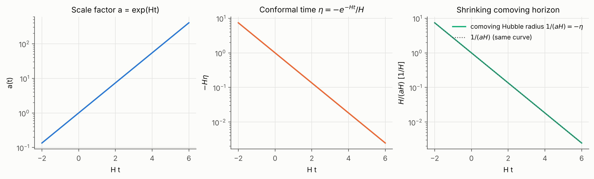
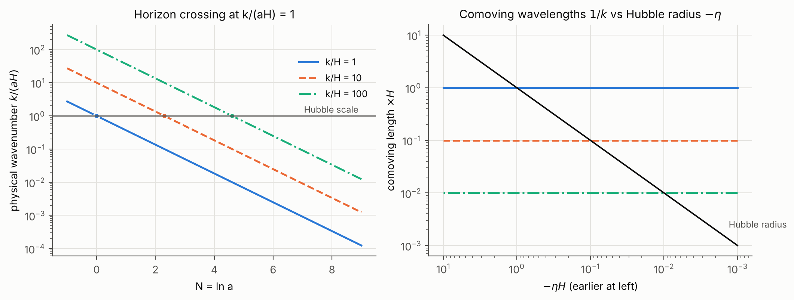
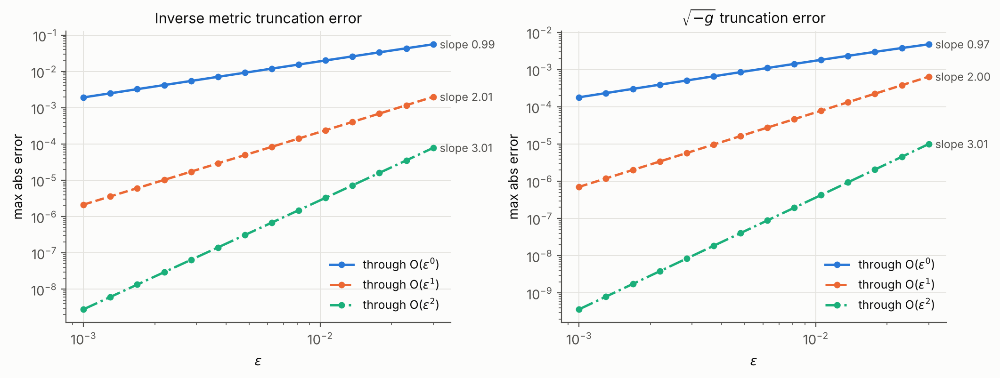
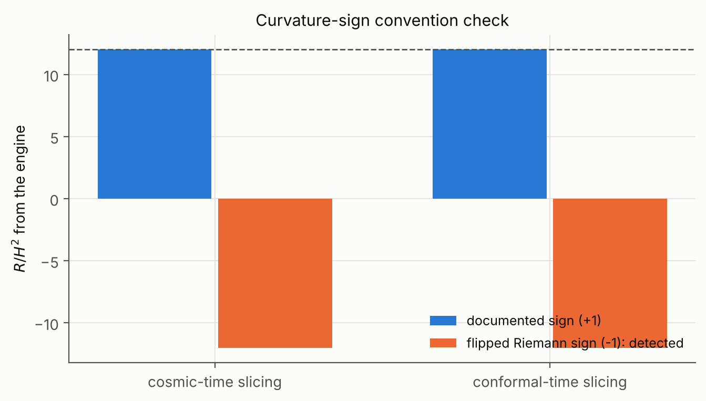

### Gauge and decomposition

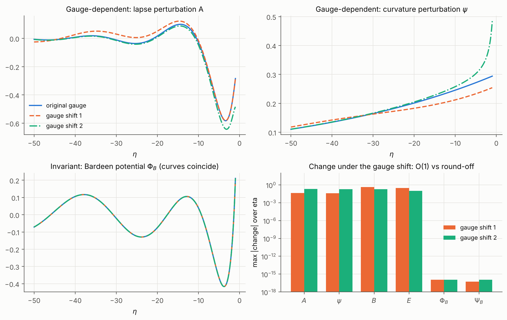
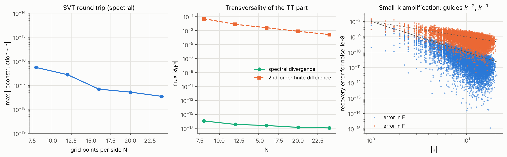

### Tensor dynamics

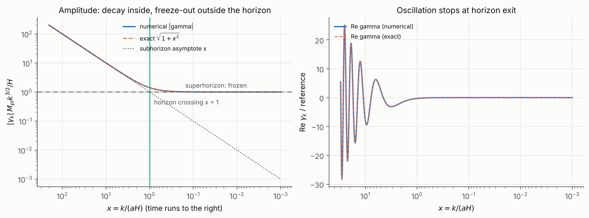
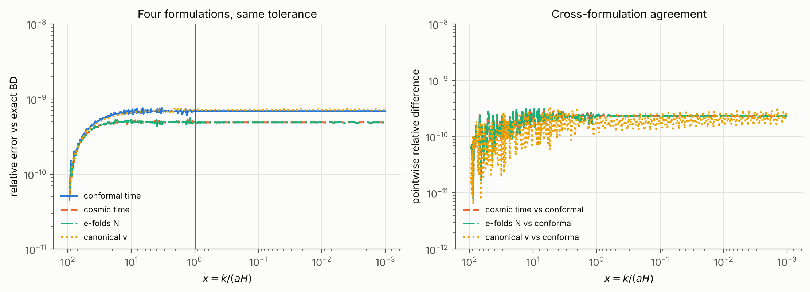
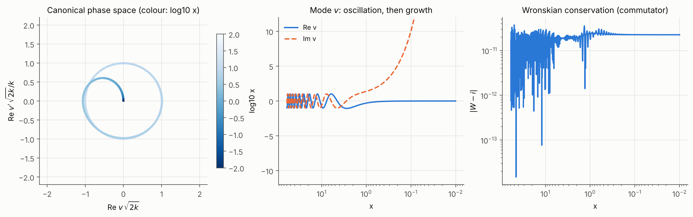

### Spectra

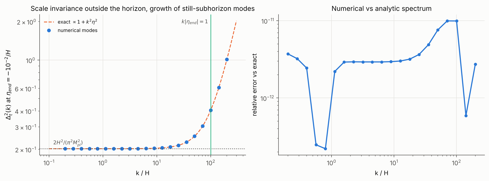
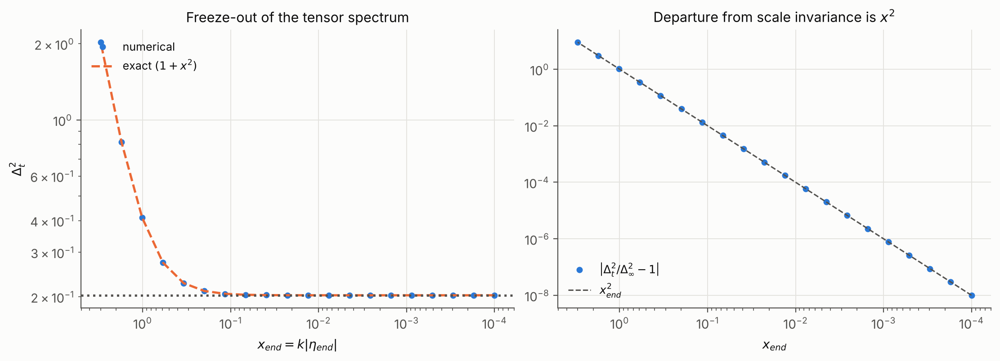
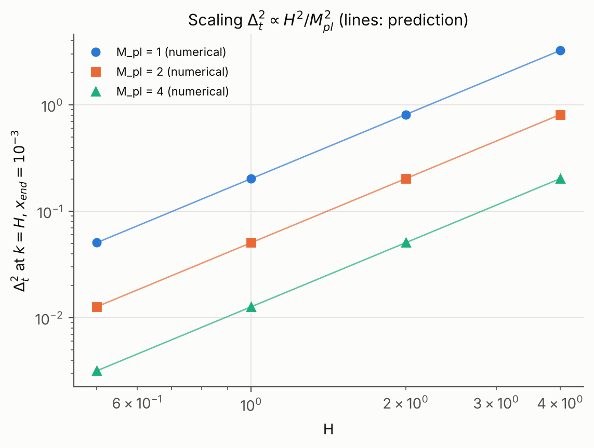
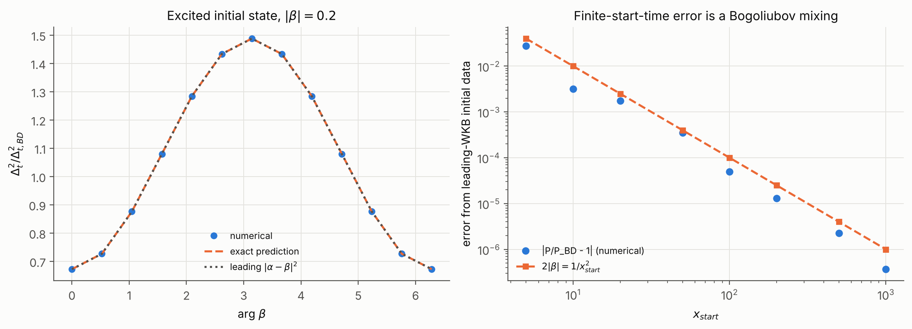

### Numerical validation

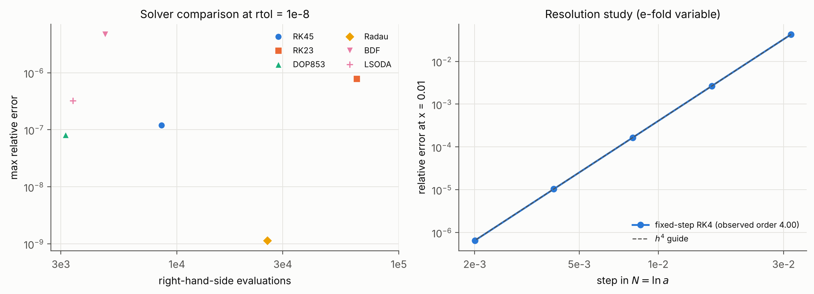
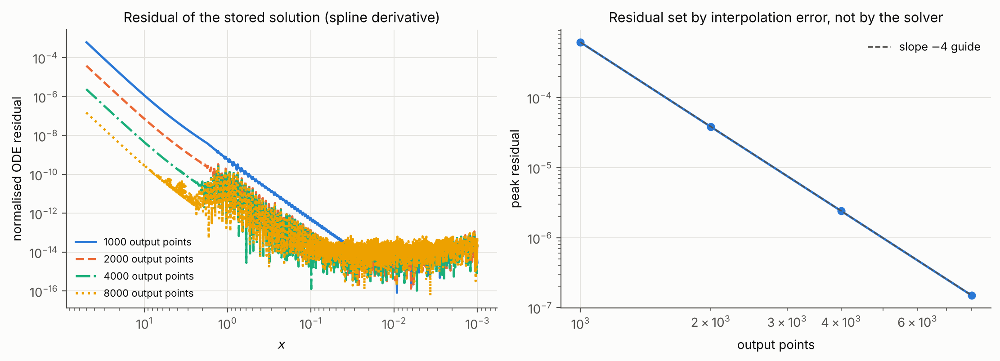
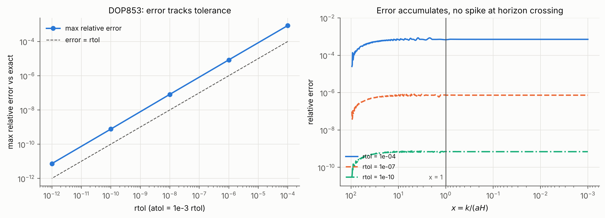

---

## Repository layout

    src/desitter_perturbations/
        conventions.py, background.py
        symbolic/        metric expansion, connections, curvature, Einstein tensor,
                         Bianchi identities, gauge transformations, quadratic action,
                         tensor decomposition
        perturbations/   scalar, vector and tensor sectors, gauge invariants,
                         constraints, numerical SVT decomposition
        dynamics/        analytic solutions, initial conditions, four-formulation ODEs,
                         solvers, residual diagnostics, convergence
        spectra/         polarizations, tensor power spectrum, parameter sweeps
        quantization/    canonical variables, normalization, Wronskian, vacua, commutators
        visualization/   plotting style and figure functions
        validation/      records, symbolic checks, analytic benchmarks, numerical checks
    tests/               15 test files, 103 tests
    scripts/             validation, figures, sweeps, benchmarks, notebooks, report
    notebooks/           14 executed notebooks
    docs/                17 documents
    figures/             geometry, perturbations, gauge, dynamics, spectra, validation
    reports/             technical report, computational methods, validation report, figure catalog
    data/                generated sweep tables (see data/README.md)

---

## Installation and quick start

    git clone <this repository>
    cd perturbative-gravity-on-de-sitter
    python -m pip install -e ".[dev]"

Minimal example (solve one tensor mode and compare with the exact spectrum):

    import numpy as np
    from desitter_perturbations.dynamics.numerical_solvers import solve_mode
    from desitter_perturbations.spectra.tensor_power import tensor_power_from_mode, power_exact

    sol = solve_mode(k=1.0, x_start=100.0, x_end=1e-3, formulation="canonical")
    P_num = tensor_power_from_mode(sol.k, sol.gamma)
    P_ex = power_exact(sol.k, sol.eta)
    print(np.max(np.abs(P_num / P_ex - 1)))

Typical use is through the scripts and Makefile:

    make test-fast     # tests without the slow symbolic ones
    make validate      # full verification suite, writes reports/validation_report.*
    make sweeps        # parameter sweeps to data/generated/
    make figures       # regenerate every figure
    make notebooks     # rebuild and execute all 14 notebooks
    make report        # reports/generated_results.md from computed values

Python 3.10 or later. Tested on Python 3.13 with numpy 2.5.3, scipy 1.18.1, sympy 1.14.0. The complete validation takes about two minutes, mostly symbolic.

---

## Verification framework

Each check is a `Record` with a tier, residual and tolerance. Three tiers: symbolic exact, analytic benchmarks, numerical. A negative control passes only when its wrong formula is detected. The protocol caught a real defect during development: sympy's `euler_equations` returned an empty list in a one-variable case, making a check vacuous, so the project uses its own Euler-Lagrange operator. Details in [docs/verification_protocol.md](docs/verification_protocol.md) and [reports/validation_report.md](reports/validation_report.md).

---

## Reproducing the results

    python scripts/run_validation_suite.py
    python scripts/run_parameter_sweeps.py
    python scripts/generate_all_figures.py
    python scripts/reproduce_report.py
    python -m pytest

The computations are deterministic; random fields in the SVT tests use fixed seeds.

---

## Documentation index

| Document | Topic |
|---|---|
| [conventions](docs/conventions.md) | Signs, normalizations |
| [de_sitter_geometry](docs/de_sitter_geometry.md) | Background curvature |
| [metric_variation](docs/metric_variation.md) | Inverse metric, determinant, connection variation |
| [linearized_curvature](docs/linearized_curvature.md) | Linearized Riemann, Ricci and Einstein |
| [gauge_symmetry](docs/gauge_symmetry.md) | Diffeomorphisms and Bianchi identities |
| [scalar_vector_tensor_decomposition](docs/scalar_vector_tensor_decomposition.md) | SVT algebra and laws |
| [constraint_equations](docs/constraint_equations.md) | Scalar and vector constraints |
| [quadratic_action](docs/quadratic_action.md) | Two-route second-order action |
| [tensor_dynamics](docs/tensor_dynamics.md) | Mode equation and exact solutions |
| [gauge_invariant_variables](docs/gauge_invariant_variables.md) | Bardeen variables, gauge experiment |
| [canonical_normalization](docs/canonical_normalization.md) | $z_T$ and the Mukhanov variable |
| [quantum_state](docs/quantum_state.md) | Wronskian, Bunch-Davies, Bogoliubov |
| [power_spectrum](docs/power_spectrum.md) | $\Delta_t^2$ |
| [numerical_methods](docs/numerical_methods.md) | Solvers and convergence |
| [verification_protocol](docs/verification_protocol.md) | Records, tiers, controls |
| [limitations](docs/limitations.md) | Scope |
| [bibliography](docs/bibliography.md) | References |

---

## Limitations

- Free field on fixed de Sitter. No interactions, loops, backreaction or full non-linear gauge fixing. This is not a theory of quantum gravity.
- No matter fluctuations, so no scalar curvature perturbation or slow-roll tilt.
- The Bunch-Davies vacuum is an input.
- Normalization depends on the polarization convention $e_{ij}e_{ij}=2$.
- Bibliographic entries should be checked against the originals before formal citation.

---

## Citation and license

See [CITATION.cff](CITATION.cff) and [references.bib](references.bib). Released under the MIT License.
